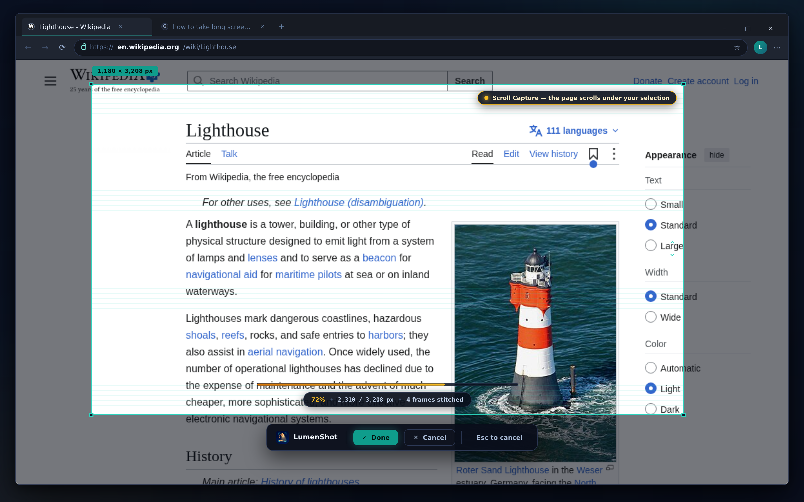

# LumenShot
> LumenShot for Windows - the AI screenshot editor that scrolls the app for you while you select

[](https://github.com/your-username/lumenshot)  [](LICENSE)

<p align="center"></p>

---

## About
LumenShot is a free, open-source **AI screenshot editor** for Windows, built in **Rust**. Its killer feature is **Scroll Capture**: you draw a selection over any app and keep holding it - LumenShot scrolls the application underneath and stitches every frame into one seamless tall image of exactly the region you picked. On top of that, a fully local AI pipeline enhances the result: auto-enhance, object removal, 2x upscaling and OCR text extraction, all running on your machine.

### Why you need LumenShot
Long conversations, changelogs, dashboards and documentation rarely fit on one screen. Capturing them today means either taking a full-page screenshot you did not want, or manually scrolling, capturing and stitching a dozen overlapping fragments in an image editor - and hoping the seams line up.

With LumenShot the workflow is one gesture: select the region, let the app scroll underneath it, release. You get a clean, seamlessly stitched image of exactly the area you cared about - no extra toolbars, no page furniture, no manual stitching. The AI tools then make it presentable: enhance it, remove cursors and popups, upscale it for retina documentation, or extract its text with OCR.

### Precautions
Screenshots regularly contain more than you intend to share - account names, personal messages, tokens in a terminal, customer data in a dashboard. Follow these basic guidelines before you export or send a capture:
* Review the **full frame** before sharing - not just the region you selected
* Use **Blur** or **Remove Object** on names, avatars, tokens and any personal data
* Remember that **OCR text** is extracted verbatim - it may include secrets from the image
* Keep the capture cache folder private if your screenshots contain sensitive material

_It is very important to note that no one associated with LumenShot will ever request your captures or the data inside them. Do not share them or any of their related details with anyone you do not trust. Developers or contributors working with LumenShot may request **example** captures created via your system to try and reproduce issues, but please ensure to redact all real personal data within such examples._

### Versions
LumenShot is under active development - the current release line is **0.1**. Region capture, the annotation toolkit and the local AI pipeline are the stable core; Scroll Capture ships as an experimental feature behind the `NEW` marker in this line.
LumenShot is built on the Rust stable toolchain (1.75 or greater) - no other platform is officially supported.

### Operating Systems
LumenShot is officially supported on:
* Windows 10 / 11 (x64)¹

## Portability
LumenShot provides a portable **Windows** version. Look for the release with the name `LumenShot-win-x64-0.1.0-portable.zip` where `0.1.0` is the version and `x64` is the architecture. The archive contains a standalone executable that requires no installation - just extract and run.

To make the most of the portable version, some environment variables are required:

| Environment Variables   | Description |
|------------------------|-------------|
| `LUMENSHOT_HOME_DIR`   | If provided LumenShot will use this path for saving __configurations__, __user settings__ or even __temporary files__ |
| `LUMENSHOT_CONFIG_DIR` | Stores __user settings__, not always needed but can be used to change config location or will default to LUMENSHOT_HOME_DIR `Optional: Only activates if LUMENSHOT_HOME_DIR is provided` |
| `LUMENSHOT_TEMP_DIR`   | Same as LUMENSHOT_CONFIG_DIR but stores __temporary files__ `Optional: Only activates if LUMENSHOT_HOME_DIR is provided` |

### Sample `LumenShotLauncher.bat` for Windows portable executable
> This example stores user settings and cache on the portable folder, but stores temporary files on the host PC.

```bat
@ECHO OFF
if not exist "%~dp0LumenShot" mkdir "%~dp0LumenShot"
set "LUMENSHOT_HOME_DIR=%~dp0LumenShot"
set "LUMENSHOT_TEMP_DIR=%temp%"
start %~dp0lumenshot.exe %*
```

## Configuration
Configuration files are stored in OS-specific locations.

### Command-Line arguments
The following arguments can be provided to LumenShot, but are all optional.
| Argument              | Description                           |
|-----------------------|---------------------------------------|
| `--capture <MODE>`    | Starts a capture immediately: `region`, `window` or `full`. |
| `--scroll`            | Enables Scroll Capture for the started capture. |
| `--delay <SEC>`       | Delays the capture start by the given number of seconds. |
| `--output <FILE>`     | Saves the result to the given file instead of the editor. |
| `--no-ai`             | Disables the local AI pipeline for this session. |
| `--no-color`          | Disables colored console output. |

### App config
Application configuration.
* Windows: `$APPDATA/LumenShot/config.json`

### Capture cache
Storage of in-progress captures and stitched frames.
* Windows: `$LOCALAPPDATA/LumenShot/Cache`

### Exported images
Default destination for saved screenshots and exports.
* Windows: `$USERPROFILE/Pictures/LumenShot`

### Logs
Logs are written for all app sessions.
* Windows: `$LOCALAPPDATA/LumenShot/Log`

_Note that logs for portable Windows applications will be written to the same directory that the executable resides in._

## Published Applications
You can view the current releases on the [LumenShot releases page](https://github.com/your-username/lumenshot/releases). Under each release are some assets - the installers and portable archives for the platforms LumenShot supports. When installing or downloading, make sure to pick the right operating system and architecture for your machine.

_Note that at this time, LumenShot only supports x64 (64 bit) machines._

### Windows
We provide an **installer** build for Windows, because it is the most desirable format for us to release: it registers global hotkeys, configures the capture overlays and supports auto-updating - a crucial feature (we feel) for a capture application. The portable **zip** does not.
**Important:** early releases are not yet code-signed, so Windows SmartScreen may show a warning on first launch. Choose _More info_ → _Run anyway_, or verify the release SHA-256 checksum published with each release. This warning disappears once signed builds are published.
We won't be supporting formats like MSI packages in the early stages as they do not align with our requirements. Issues requesting these formats will be closed immediately. Discussion on topics like this should be started on other social channels.

## Development
To begin developing features or bug-fixes for LumenShot, make sure that you first have Rust stable **1.75** or greater installed with Cargo (via [rustup](https://rustup.rs)).

Once cloned, build the project and run the test suite:
```sh
cargo build --release
cargo test
```
The editor binary will be placed in `target/release/lumenshot.exe`. To try a capture against the current screen:
```sh
cargo run -- --capture region --scroll
```

### Contributing
There are a number of ways you can contribute to LumenShot!

#### Features & Bug fixes
We welcome pull-requests and issues that serve to better LumenShot as a platform. Please remain respectful (this is free & open source after all) with your ideas and observations, and always consider opening an issue before starting on a substantial pull request.

#### Translations
LumenShot relies on the community for translating its interface and report messages into languages besides English. We use British English (en_GB) as the base language, and translate into all others that our contributors are kind enough to provide.
To add support for a language:
* Copy the `resources/i18n/translations/en.json` file to the language code you're providing (eg. `fi.json` for Finnish).
* Edit the `resources/i18n/translations/index.rs` file and register the new JSON file in the locale table.

#### Contributions
This project exists thanks to all the people who contribute. [[Contribute]](CONTRIBUTING.md).
#### Backers
Thank you to all our backers! [[Become a backer](https://opencollective.com/lumenshot#backer)]
#### Sponsors
Support this project by becoming a sponsor. Your logo will show up here with a link to your website. [[Become a sponsor](https://opencollective.com/lumenshot#sponsor)]

## Notes and Caveats
* ¹ LumenShot is Windows-first. Linux and macOS builds are planned but not officially supported - they may work from source, but no release binaries are provided.
* ² LumenShot is not affiliated with any of the companies represented in screenshots or preview images.
* The AI pipeline runs entirely on your machine. Captures, OCR results and enhanced images never leave your PC, and LumenShot does not include an account system or any telemetry.
